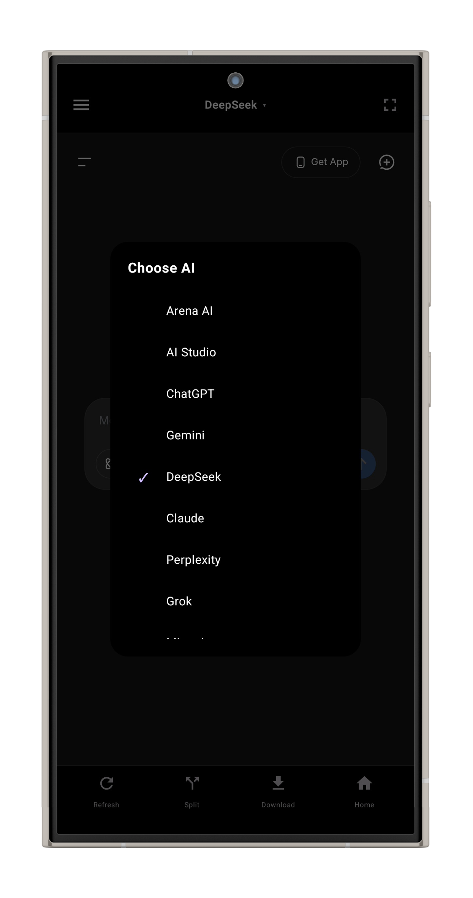
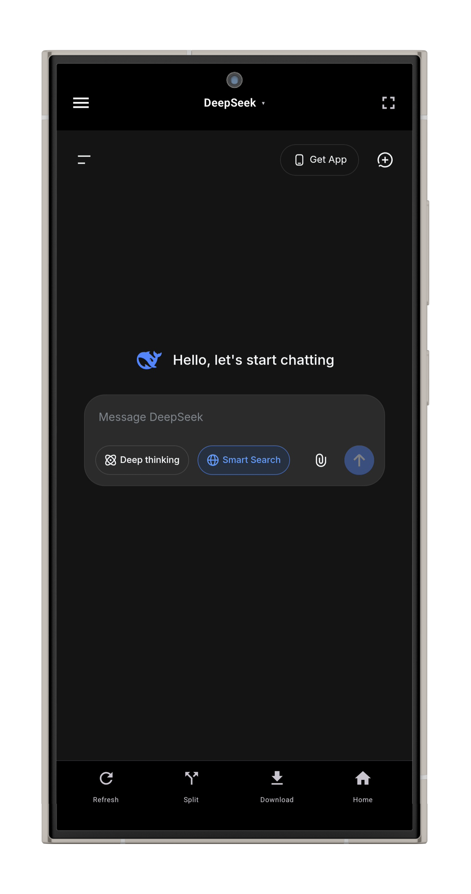
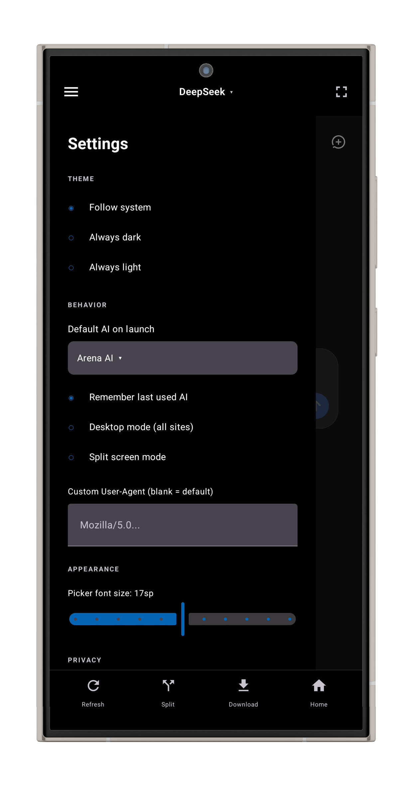

# 🌌 Luminex AI

---

## 📖 About The Project

**Luminex AI** is a unified, fast, tab-based Android browser that wraps leading AI web interfaces into a single app. Typed text, chat history, and scroll positions are preserved across switches, meaning you never lose your place, your text, or your flow between models.

## 📸 Screenshots

  
  
  

## 🤖 Supported AI Sites

Luminex currently wraps **13 AI websites** into a seamless native experience:
*   **AI Studio** · **ChatGPT** · **Gemini** · **DeepSeek** · **Claude** · **Perplexity**
*   **Grok** · **Mistral** · **NotebookLM** · **Ptero** · **Genspark** · **Duck.ai**
*   **Arena AI**

## ✨ Key Features

*   **Browser-Style Tabs:** Keep up to 5 AI sites fully alive. Zero reloads, instant switching.
*   **Split Screen:** Run two AI models side-by-side. Drag the divider to resize. One-tap swap to flip panes.
*   **Full Screen Mode:** Double-tap anywhere on the screen to toggle full screen on or off. Hides both bars for maximum chat space.
*   **Custom User-Agent + Desktop Mode:** Override how sites see your device. Force desktop layout for any AI service with a single toggle.
*   **Download & Save:** Capture generated files and images directly. Downloads save to your Downloads folder and appear in your Gallery.
*   **Image Long-Press Menu:** Save, copy URL, open in browser, or share any image on the page.
*   **Privacy First:** "Prevent Screenshots" toggle to block screenshots for sensitive AI conversations.
*   **Quality of Life:** Remember last used AI and a quick Site Picker dialog.

## 🛠️ Tech Stack

*   **Language:** [Kotlin](https://kotlinlang.org/)
*   **UI Framework:** [Jetpack Compose](https://developer.android.com/jetpack/compose)
*   **Architecture:** MVVM (Model-View-ViewModel)
*   **Dependency Injection:** [Hilt](https://dagger.dev/hilt/)
*   **Web Engine:** Android `WebView` with custom `WebViewClient` & `WebChromeClient` logic.

## 👨‍💻 Author

**Faiman Habib**

## 📄 License

This project is licensed under the MIT License.
